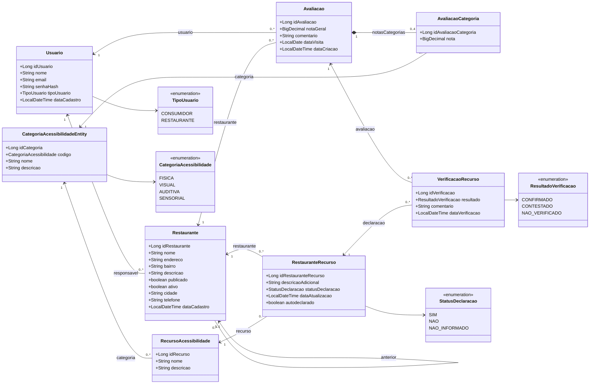
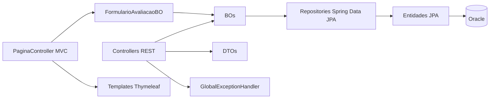
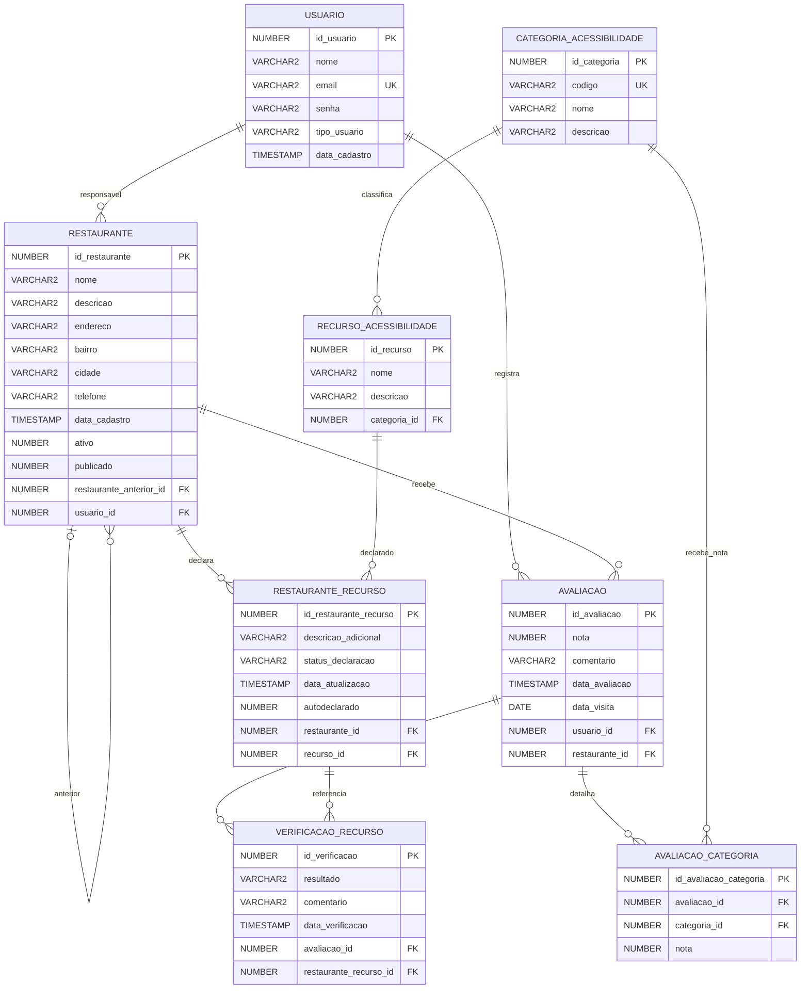

# Pré-visualizações Mermaid

Este arquivo é a versão renderizável dos arquivos `.mmd` quando aberto em GitHub ou visualizador Mermaid compatível. Os arquivos `.mmd` permanecem como fonte editável para exportação futura.

## UML de domínio

## Arquitetura em camadas

## DER Oracle

